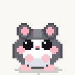

# Gunther - Desktop Companion 🐹❤️

Un piccolo compagno virtuale dedicato a Gunther, creato con affetto per passeggiare sullo schermo del computer, tenere compagnia e donare un sorriso ogni volta che lo si guarda.



---

## ✨ Funzionalità

- **Animazioni Dolci e Dettagliate**:
  - 🌸 **Idle**: Respira pacificamente, arriccia il nasino e muove le orecchie.
  - 🚶 **Passeggiata**: Cammina dolcemente avanti e indietro lungo la barra delle applicazioni.
  - 🌻 **Sgranocchia**: Quando ha fame, si siede sulle zampe posteriori e mangia un semino di girasole.
  - 💤 **Pisolino**: Si rannicchia in una morbida pallina con tanto di "Zzz" animate.
  - 🐾 **Coccole**: Se ci clicchi sopra, chiude gli occhi felice, arrossisce ed emette cuoricini fluttuanti.
  - 🪂 **Prendi e Trascina**: Puoi sollevarlo con il mouse (zampette a penzoloni!) e rilasciarlo: scenderà delicatamente grazie alla gravità.

- **Pensieri Dolci**:
  - Ogni tanto compare un fumetto delicato con frasi confortanti, ricordi d'idratazione e parole d'affetto.
  - Tutti i messaggi sono integrati nel codice in [gunther/messages.py](./gunther/messages.py) e incorporati nell'eseguibile.

- **Varianti di Manto**:
  - 🐹 **Gunther (Manto Originale)**: Pelo grigio scuro caldo, pancino bianco candido e visetto pulito senza baffi.
  - 🌰 **Dorato Classico (Siriano)**
  - ❄️ **Bianco Invernale (Snow / Winter White)**
  - 🪨 **Grigio Zaffiro (Russo)**
  - 🐼 **Panda Pezzato**

- **Integrazione Tray**:
  - Icona nella barra di sistema (vicino all'orologio di Windows) per richiamarlo, dargli un semino o svegliarlo.

---

## 🎮 Comandi e Interazioni

| Azione | Risultato |
| :--- | :--- |
| **Clic Sinistro** | Fai una coccola a Gunther (arrossisce e genera cuori) |
| **Doppio Clic** | Dagli subito un semino di girasole da sgranocchiare |
| **Clic e Trascina** | Sollevalo e spostalo ovunque sullo schermo |
| **Clic Destro** | Apre il menu completo (cambio manto, dimensioni, cibo, sonno, impostazioni) |
| **Doppio Clic su Tray** | Riporta Gunther immediatamente al centro dello schermo |

---

## 🚀 Come Avviarlo

### Metodo 1: Download da GitHub Releases (Consigliato per lei!)
Scarica l'ultimo file `Gunther.exe` pronto all'uso direttamente dalla pagina **Releases** del repository GitHub.
- **100% Autonomo e Pulito**: Non genera né legge alcun file su disco; impostazioni, animazioni e messaggi sono tutti integrati direttamente all'interno dell'eseguibile.
- Le basterà fare doppio clic su `Gunther.exe` e Gunther comparirà subito sullo schermo senza dover installare nulla!

### Metodo 2: Doppio Clic sullo Script
Fai doppio clic su `Avvia_Gunther.bat` (avvia l'app in background senza finestre nere di terminale).

### Metodo 3: Da Riga di Comando
```powershell
uv run main.py
```

---

## 🔨 Come Compilare l'Eseguibile (.exe)

Puoi ricompilare l'applicazione in qualsiasi momento usando il comando unico [build.py](./build.py) specificando il target desiderato con il parametro `--target` (oppure avviando [Build.bat](./Build.bat) per il menu interattivo).

### 🐹 1. Solo Gunther (Manto Originale Esclusivo)
Crea un eseguibile dedicato al 100% a Gunther (senza manti alternativi):
```powershell
uv run build.py --target gunther
```
*(Oppure doppio clic su [Build_Gunther_Solo.bat](./Build_Gunther_Solo.bat))*

### 🌰 2. Tutti i Criceti (5 Manti)
Include tutte le varianti di colore dei criceti (Gunther, Dorato, Invernale, Zaffiro, Panda):
```powershell
uv run build.py --target criceti
```
*(Oppure doppio clic su [Build_Completo.bat](./Build_Completo.bat))*

### 🦆 3. Tutte le Paperelle (6 Varianti, con Paperella Bianca)
Crea l'eseguibile dedicato **`Paperella.exe`** a tema paperella, con beccate, pisellini, pensieri dedicati e piumaggio selezionabile (inclusa la Bianca):
```powershell
uv run build.py --target paperelle
```
*(Oppure doppio clic su [Build_Paperelle.bat](./Build_Paperelle.bat))*

Gli eseguibili generati si troveranno sempre nella cartella `dist/` (`dist/Gunther.exe` o `dist/Paperella.exe`) e funzioneranno come file singoli 100% autonomi.

---

## 🐾 Come Aggiungere Nuovi Animali in Futuro

Il progetto utilizza un'architettura modulare in [gunther/species.py](./gunther/species.py):
1. Registra una nuova specie in `SPECIES_REGISTRY` definendo nome, emoji, azioni del menu (cibo, coccole, sonno), pensieri dedicati e palette.
2. Inserisci o genera gli sprite corrispondenti nella sotto-cartella `assets/sprites/<nuovo_animale>/`.
3. Il sistema adatterà automaticamente il menu, le coccole, le azioni e i comandi di compilazione per il nuovo animale.
